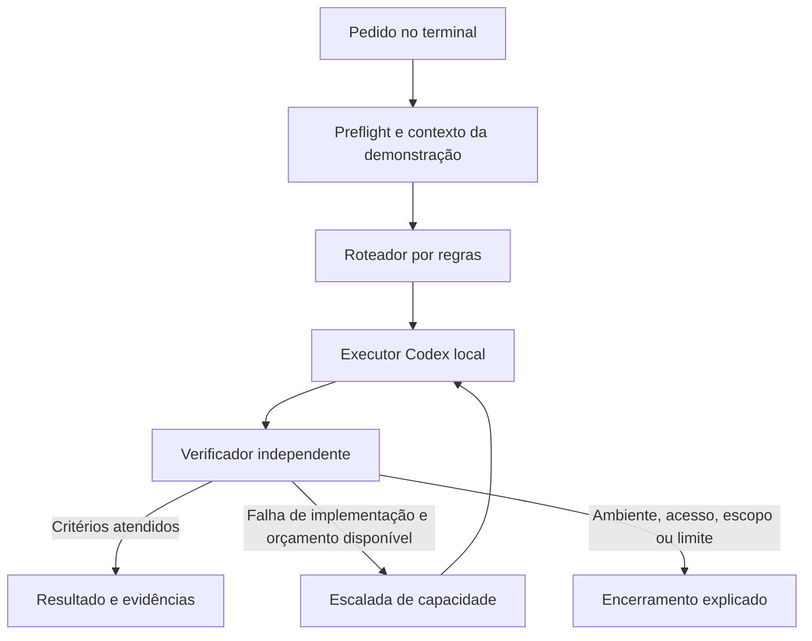

# Relay: desenho do protótipo de viabilidade

Status: desenho aprovado pelo usuário em 2026-10-24, em resposta à sua apresentação.
O [plano de implementação](2026-10-24-prototipo-relay-plan.md) e seu
[anexo de contratos](2026-10-24-prototipo-relay-contracts.md) detalham a etapa
seguinte, aprovada pelo usuário em 2026-10-24. Este documento registra o desenho;
o estado implementado e as provas ficam em [setup](../setup.md).
Revisão independente concluída: uma lacuna de isolamento do runner foi corrigida
e revalidada no desenho. A implementação posterior segue o plano aprovado.

## 1. Objetivo e decisões existentes

Demonstrar que um pedido no terminal pode produzir uma correção verificada,
selecionando capacidade automaticamente dentro da assinatura Codex da pessoa.
O primeiro público proposto é quem já usa Codex e quer aproveitar melhor seu uso.
Isso é uma hipótese de público, não uma validação de mercado.

Confirmado pelo usuário: nome Relay, interface de terminal, assinatura existente,
autenticação oficial e seleção automática sem confirmação por troca de modelo.
A visão inclui múltiplos agentes; o primeiro experimento usa um executor por vez.
Nenhuma economia percentual, acesso a modelos ou integração foi demonstrada ainda.

## 2. Recorte e alternativas

| Abordagem | Vantagem | Custo / limite | Decisão proposta |
| --- | --- | --- | --- |
| Cliente próprio sobre Codex App Server local | Controle explícito de sessões, eventos, escolha e interrupção | Adaptar protocolo e autenticação à versão real | Recomendada |
| Processos independentes com Codex exec | Bom para tarefas isoladas | Conversa, aprovações e ciclo de vida exigem outra integração | Alternativa para reavaliar se o App Server bloquear o experimento |
| Harness próprio sobre inferência direta | Controle integral de ferramentas | Reimplementar execução, recuperação e isolamento | Fora deste protótipo |

Proposta técnica: TypeScript sobre Node.js 24, npm e testes nativos do Node após
compilação. O ambiente já possui Node/npm; nada será instalado globalmente.
Dependências, versões e comandos novos serão definidos no plano de implementação.
Primeira plataforma de validação: Windows/PowerShell deste ambiente. Portabilidade
fica no desenho; Linux/macOS só receberão selo de suporte após testes próprios.

Primeira entrega executável: uma tarefa por invocação, sobre um projeto sintético
criado pelo Relay. Conversa contínua, projetos arbitrários, várias linguagens,
paralelismo, dashboard, nuvem, outros provedores e publicação ficam para depois.
Esse recorte permite testar a ideia sem prometer um substituto completo do Codex.

## 3. Experiência pretendida

Os comandos abaixo são propostos e ainda não existem:

```text
relay doctor
relay demo "Corrija o cálculo de desconto e preserve os casos válidos."
```

`doctor` verifica executáveis, versão/protocolo e configuração não secreta; não
executa inferência. Não imprime identidade, tokens ou conteúdo de arquivos de login.
`demo` cria uma cópia descartável do caso conhecido, prepara autenticação quando
necessário e apresenta a tarefa no terminal. A conexão da conta pode abrir o
navegador oficial; não existe cadastro próprio, site ou frontend do Relay.

Na primeira preparação, a pessoa vincula dois perfis de capacidade a combinações
permitidas de modelo/esforço. Depois disso, as decisões da execução são automáticas.
Permissões de arquivos/comandos continuam distintas da seleção de modelo.

Saída legível: tarefa, etapa atual, perfil escolhido e motivo curto, verificações,
eventual escalada, resultado e consumo observado. Motivos descrevem decisões do
sistema; não exibem raciocínio interno do modelo. Estados de erro explicam a causa
e a próxima ação. Cor não é necessária para entender a saída; Ctrl+C interrompe.

## 4. Componentes e fluxo



| Responsabilidade | Entrada / saída | Limite |
| --- | --- | --- |
| CLI | Pedido e opções; mensagens de progresso e encerramento | Não interpreta pedido como comando de shell |
| Autenticação | Consentimento oficial; sessão autorizada para o plano | Credenciais fora do Git, sem copiar o login interno de outro aplicativo |
| Adaptador Codex | Mensagens estruturadas; eventos normalizados | Único dono do processo filho e do protocolo |
| Política e roteador | Tarefa delimitada, perfis e evidência; próxima ação | Determinístico inicialmente, sem chamada LLM apenas para rotear |
| Verificador | Arquivos de resultado e caso esperado; pass/fail/categoria | Avaliador e critérios fora do escopo de escrita do executor |
| Relatório | Eventos, verificações e métricas disponíveis | Sem credenciais, histórico bruto ou afirmação de economia não medida |

O adaptador inicia o executável com argumentos estruturados e comunicação por
stdio, sem montar comandos a partir do prompt. Correlaciona respostas por ID e
eventos por sessão/turno; tolera eventos opcionais desconhecidos. Erros, fechamento
do processo e JSON inválido encerram explicitamente, sem estado de sucesso falso.
Uma resposta final do modelo não substitui o término confirmado da execução.

O primeiro contexto vem de um manifesto controlado da demonstração: pedido,
contrato da função e poucos arquivos relevantes. Não há indexador, grafo ou
varredura indiscriminada do computador. Uma escalada recebe o diff e o diagnóstico
necessários; a política de contexto deve ter limite explícito em bytes/tokens
quando a medição existir. O experimento deve registrar esse custo também.

## 5. Autenticação e acesso: primeira prova técnica

Usar o fluxo oficial atual para aplicativo aberto/local com uso do plano ChatGPT,
integrado ao Codex. Esse é um cliente próprio: não presumir que instalar o Relay
permita copiar ou reutilizar automaticamente as credenciais privadas do Codex.
O caminho recomendado será comprovado antes de construir o restante do executor.

A implementação deverá tratar consentimento, validação OIDC/PKCE, identidade,
permissões concedidas, expiração, renovação e cancelamento conforme as fontes
oficiais. Tokens ficam no armazenamento local protegido do usuário, fora do
repositório e dos logs; o caminho e a proteção no Windows serão verificados no
plano. Apenas o processo filho recebe o token necessário. O login de outros apps
e a configuração global existente não são substituídos.

Separar catálogo, combinações suportadas e acesso comprovado. Descobrir opções
da conta pelo caminho oficial e cruzar com os esforços aceitos pelo protocolo.
Um turno concluído comprova acesso naquela execução; o catálogo isolado não.
O rótulo de um modelo não comprova preço ou competência. Os dois perfis são
configurados uma vez e podem apontar a modelos diferentes ou esforços diferentes.

Se só uma combinação estiver disponível, registrar viabilidade parcial. Trocar
somente esforço não demonstra roteamento entre modelos. Acesso negado, ausência
de consentimento, incompatibilidade e cota esgotada encerram com diagnóstico;
não ativam uma API cobrada, conta diferente ou outro provedor como fallback.

## 6. Seleção, escalada e encerramento

Perfis lógicos: `economico` e `robusto`. Os nomes comerciais não são fixados no
código. Na tarefa simples conhecida, começar no perfil econômico configurado.
O roteador não tenta descobrir capacidade real apenas pelo texto livre do pedido.
Pedidos fora do contrato do caso param como escopo não suportado ou ambíguo.
Futuras tarefas de maior risco poderão começar no robusto, após critérios próprios.

| Evidência | Próxima ação |
| --- | --- |
| Contrato e testes externos satisfeitos; alterações dentro do escopo | Concluir sem escalar |
| Teste funcional falha por resultado da alteração; existe perfil superior | Escalar uma vez, com diagnóstico e diff |
| Fonte resulta em erro sintático atribuível à alteração | Mesma escalada única; não criar uma terceira tentativa |
| Requisito ambíguo ou pedido fora do caso | Pedir esclarecimento ou encerrar; não gastar com modelo maior |
| Dependência, processo, permissão ou ambiente falha | Encerrar como problema de ambiente; preservar evidência |
| Login/cota/modelo indisponível | Encerrar como acesso indisponível; não circular por outros modelos |
| Resultado vazio, eventos incoerentes ou diagnóstico inconclusivo | Encerrar como inconclusivo; não assumir uma falha de código |
| Tempo, cancelamento ou tentativas esgotados | Interromper, aguardar encerramento e produzir relatório parcial |

Limite proposto: dois turnos de síntese por tarefa adaptativa, um inicial e uma
escalada; 180 segundos por tentativa e 600 segundos por execução completa,
incluindo validação. Login tem timeout próprio de 180 segundos e não fica
consumindo a janela da tarefa. Estes valores são configurações propostas.

Turno não equivale a uma chamada de inferência: o Codex pode executar ciclos
internos. Registrar o que for observável; não prometer um teto exato de tokens
ou de consumo de assinatura que o backend não ofereça. Ao atingir timeout ou
Ctrl+C, pedir interrupção, esperar até 10 segundos, depois encerrar apenas o
processo/descendentes criados pelo Relay e confirmar que cessaram. Não iniciar
outra tentativa se o executor anterior puder continuar escrevendo.

## 7. Caso demonstrável e validação independente

Caso proposto: função JavaScript de desconto com um erro delimitado. O contrato
define valor finito não negativo, percentual entre 0 e 100, resultado matemático
correto, preservação das entradas e rejeição explícita de entradas inválidas.
A representação de decimais e as expectativas serão fixadas antes do código do
avaliador; não usar dados ou operações financeiras reais.

O prompt comum descreve o comportamento desejado. Um avaliador conhecido executa
testes positivos, limites e entradas inválidas antes/depois. A versão defeituosa
deve falhar no caso específico e passar nos controles; a versão de referência
deve passar. Só a função da demonstração é editável. Testes, contrato e resultado
esperado são protegidos pelo coordenador; seus hashes são conferidos ao final.

O executor trabalha em uma cópia nova com escrita limitada. Permissões são
verificadas pelo mecanismo suportado, não por uma instrução no prompt. Não herdar
plugins, servidores MCP ou permissões pessoais sem necessidade e consentimento.
Solicitações fora da política são recusadas ou apresentadas, sem aprovação ampla.
Se o ambiente não conseguir proteger o avaliador e limitar a escrita, o caso de
edição permanece bloqueado; não se desativa o isolamento para obter um resultado.

O verificador executa um programa conhecido por argumentos, sem interpolar o
pedido. O programa conhecido não torna o JavaScript candidato confiável: o
coordenador nunca importa esse código no próprio processo. Os casos e resultados
esperados ficam no avaliador confiável; a função candidata roda em um processo
descartável separado, sob política restritiva, sem credenciais, rede ou escrita
no avaliador. Só os dados do caso e a resposta atravessam essa fronteira.

O runner recebe ambiente mínimo, sem herdar o token OAuth ou variáveis privadas
do coordenador/App Server. A política deve restringir acesso aos arquivos
necessários e impedir escrita nos testes. A implementação exata dessa fronteira
no Windows será especificada e comprovada no plano; processo separado ou Node vm
isoladamente não constituem uma garantia de sandbox.

Timeout proposto para validação: 5 segundos por caso e 20 segundos por conjunto,
sempre dentro da janela restante da execução. Encerramento antecipado, inclusive
exit 0 sem respostas completas, exceção no runner, saída malformada ou laço
infinito produzem falha explícita, nunca aprovação. O avaliador confere cada
resultado esperado fora do processo candidato; não confia só no código de saída
ou em uma mensagem de sucesso escrita pelo candidato. O encerramento confirmado
e a regra contra processos concorrentes da seção 6 valem para esse runner também.

Testes locais devem injetar candidatos com laço infinito, process.exit(0), saída
incompleta e tentativa de escrita nos testes. A prova de proteção usa apenas
arquivos/valores sintéticos. Se o isolamento não puder ser comprovado, bloquear
execução do candidato sem reduzir permissões para contornar a falha.

Alterações fora da lista, remoção de verificações ou processo ainda ativo impedem
conclusão. Não aplicar o resultado em outro repositório automaticamente. Falhas
ficam disponíveis para inspeção; remoção só de cópias próprias identificadas.

## 8. Evidência e comparação

Registrar por tentativa: ID local, versão Relay/Codex, perfil, modelo/esforço
solicitados, reroteamento informado quando existir, duração, estado final,
verificações, diff e métricas recebidas. Não afirmar modelo efetivo quando só o
solicitado for observável. Agregar snapshots cumulativos sem somá-los repetidamente;
separar entrada, cache, saída e raciocínio conforme a versão disponibilizar.
Valores ausentes aparecem como indisponíveis, nunca como zero.

Comparação opcional e limitada: mesma tarefa e estado inicial em outra cópia com
perfil robusto direto. No máximo três turnos de síntese no conjunto (até dois
adaptativos e um de referência), sem classificação LLM ou revisão extra automática.
Só rodar essa comparação quando estiver incluída no orçamento aprovado da prova.
Não forçar uma falha real para encenar escalada: o teste controlado do roteador
usa um adaptador falso, claramente identificado; o resultado ao vivo pode passar
de primeira. A prova ao vivo registra a trajetória que realmente ocorreu.

Comparar conclusão, regressões, tempo e tokens observados. Percentual da janela
da assinatura é agregado e pode sofrer uso concorrente; não atribuir sua diferença
inteira ao Relay nem converter tokens em dinheiro. Uma dupla de execuções mostra
viabilidade e um exemplo comparativo, não uma taxa de economia generalizável.

## 9. Critérios de aceitação

| ID | Critério | Evidência esperada |
| --- | --- | --- |
| A1 | Preflight separa falta de binário, protocolo e configuração | Testes locais sem rede/inferência, erros distintos |
| A2 | Login oficial concede uso do plano; cancelamento e expiração tratados | Fluxo real consentido; testes de callbacks inválidos; tokens ausentes de logs |
| A3 | Dois perfis contêm combinações suportadas e acesso é rotulado corretamente | Catálogo registrado; conclusão real ou limitação explícita de acesso |
| A4 | Roteamento e uma escalada funcionam sem confirmação por troca | Testes determinísticos com adaptador falso; máximo de dois turnos adaptativos |
| A5 | Ambiente/acesso/ambiguidade não são tratados como erro de implementação | Cenários separados sem nova inferência indevida |
| A6 | Cancelamento/timeout não deixam executor ou runner ativos | Teste de ambos os processos próprios, laço infinito e ausência de tentativa concorrente |
| A7 | Avaliador detecta o defeito, aceita a referência e trata candidato não confiável | Baseline falha; referência passa; hashes preservados; exit 0 prematuro, saída incompleta e escrita proibida não aprovam |
| A8 | Uma tarefa real do caso termina verificada ou falha honestamente | Estado terminal, diff dentro do escopo, testes externos e relatório |
| A9 | Consumo ausente/cumulativo e modelo solicitado são representados corretamente | Testes de agregação, dados ausentes e limites sem economia inventada |
| A10 | Comparação, se selecionada, usa cópias equivalentes e orçamento separado | Até três turnos totais; resultado e limitações registrados |

Aceite completo exige fluxo real concluído e verificações relevantes passando.
Um adaptador falso valida o controlador, não prova uso da assinatura. Acesso a
apenas um perfil, login indisponível ou isolamento insuficiente produzem resultado
parcial/bloqueado com causa e próxima ação, sem declarar o produto viável por completo.

## 10. Entregas propostas após aprovação do desenho

1. Escrever e revisar o plano executável, com arquivos, contratos e testes exatos.
2. Implementar preflight/transporte e testes sem inferência; provar autenticação.
3. Implementar controlador, fixture e verificador; exercitar falhas controladas.
4. Fazer a execução real delimitada, revisar o resultado e registrar evidência.
5. Selecionar a próxima etapa do produto somente a partir desse resultado.

Custos, login e escrita local do aplicativo devem estar claros na aprovação do
plano futuro. Não há execução de modelos, credenciais novas, instalação, publicação,
mudança global ou trabalho em segundo plano autorizado por este documento sozinho.

## 11. Fontes e evidência desta etapa

Consultadas em 2026-10-24:

- [Codex App Server](https://learn.chatgpt.com/docs/app-server)
- [Uso do plano em aplicativo local aberto](https://developers.openai.com/siwc/token-sharing-open-source)
- [Registro e login](https://developers.openai.com/siwc/token-sharing-open-source/sign-in)
- [Catálogo e inferência](https://developers.openai.com/siwc/token-sharing-open-source/models-and-inference)
- [App Server com Sign in with ChatGPT](https://developers.openai.com/siwc/token-sharing-open-source/codex-app-server)
- [Limitações atuais desse caminho](https://developers.openai.com/siwc/token-sharing-open-source/preview-limitations)

Context7: resolvido `/openai/codex` e consultado um conceito de seleção de
modelo/esforço e eventos. Como as versões indexadas não coincidem exatamente
com o executável local, a evidência prioritária foi o schema gerado por esse CLI.

Observado: Node v24.18.0, npm 11.16.0, Codex CLI 0.163.0-alpha.11.2. Comandos
de ajuda e geração local de schema passaram; `TurnStartParams` contém `model` e
`effort`; `ThreadTokenUsageUpdatedNotification` contém sessão, turno e consumo.
SHA-256 de `v2/TurnStartParams.json` gerado sem campos experimentais:
`835E0D4CA1A0DDC4FB6DB1E2B3249DD67F07C50AC2506092BA81543EFC92829B`.
Os schemas ficaram em recurso temporário fora do projeto; nenhum contrato gerado
foi incorporado ao aplicativo. Não houve handshake, login ou inferência de Relay.

O CLI apresentou avisos de acesso negado para aliases/limpeza de seu diretório
temporário, mas retornou sucesso nessas inspeções. Não foram alteradas permissões
para ocultar o aviso. A leitura de um caminho temporário de outra invocação falhou;
a inspeção foi refeita gerando e lendo o schema na mesma invocação. Isso não é
evidência de uma integração funcional nem de falha de modelo.
